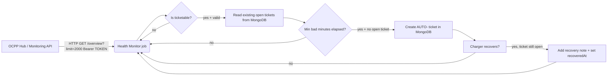
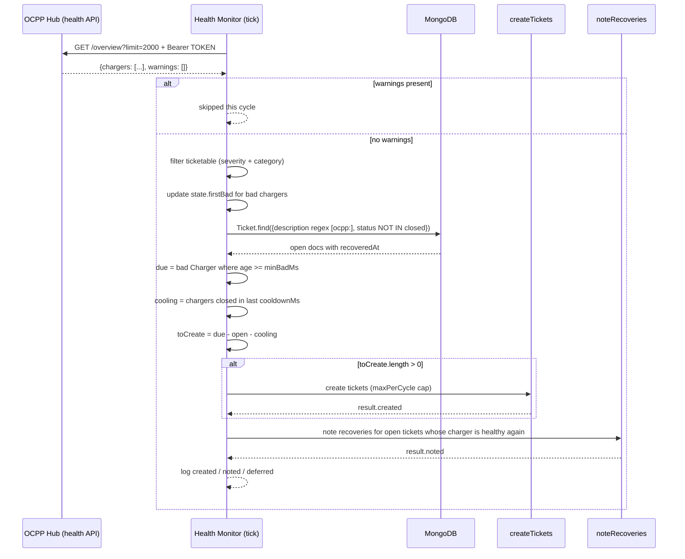

# Auto Ticket & Charger Health Monitor

This module provides **automatic ticket creation** driven by an external OCPP charger health monitoring API. When the health monitor detects a charger in a  or  severity state, it automatically creates a support ticket (with  prefixed ) for that charger and assigns it a recovery note when the charger goes back to normal.

---
## 1. Architecture Overview



The auto-ticket subsystem is split into two parts:

- **`Health.js`** - a standalone ad-hoc script for manual or one-off running (`node Health.js`, `node Health.js alert`). Always uses `TECH_TOKEN`.
- **`utils/healthMonitor.js`** - the production health monitor integrated into the Express app. It is started from `index.js` after the database connects.

> For production use, always run `node index.js` (which starts the monitor) rather than invoking `Health.js` directly. `Health.js` exists as a debugging/ad-hoc tool.

---

## 2. How the Auto-Ticket Is Generated

### 2.1 Trigger: Who creates the ticket?

Tickets are created exclusively by the **charger health monitor**. There are two entries:

1. **Production monitor** (`utils/healthMonitor.js` -> `startHealthMonitor()`)
   - Called from `index.js` after `connectDB()` resolves.
   - Runs on an interval (default: every 60 seconds).
   - Configuration is read from environment variables (`CHARGER_TICKET_*`).

2. **Ad-hoc script** (`Health.js`)
   - Can be run manually for one-off or continuous checks.
   - Must be pointed at a real `TECH_TOKEN`.

Both use the same underlying logic (`createTickets()`), which:

1. Reads the latest charger health overview from the OCPP hub API.
2. Filters for chargers that are both `severity` (e.g. `critical`, `high`) and `category` (e.g. `active_issue`), i.e. real running problems - not stale `long_offline` data.
3. Loads all currently **open** tickets from MongoDB that carry an `[ocpp:<id>]` tag in their `description`.
4. Computes how long each charger has been bad (`firstBad` map) using the `minBadMs` (default: 10 minutes) threshold.
5. Respects a **cooldown** (`CHARGER_TICKET_COOLDOWN_HOURS`, default: 2 hours) after a ticket has been closed.
6. Respects `maxPerCycle` (default: 25) cap so a single cycle never creates thousands of tickets.
7. Calls `Ticket.create()` for each eligible charger.

### 2.2 Ticket data model (what gets written)

```js
{
  ticketNumber:    `AUTO-${Date.now()}-${String(Math.floor(Math.random() * 1000)).padStart(3, "0")}`,
  type:            "auto",
  subject:         `Charger issue: ${c.chargerName} [${sev}]`,
  description:     `Charger ${c.chargerName} (${c.stationName}) has ${sev} severity: ${issues}.${off} [ocpp:${c.ocppId}]`,
  customerName:    "Auto-detected",
  departmentId:    cfg.departmentId || creator.departmentId,
  priority:        PRIORITY[c.severity] || "medium",
  status:          "open",
  createdBy:       creator._id,
  faultDescription: issues,
  escalationHours: 24,
  resolutionType:  null,
  recoveredAt:     null,
  createdAt:       Date.now(),
  updatedAt:       Date.now()
}
```

- `ticketNumber` always starts with `AUTO-` (the random suffix avoids collisions).
- `type` is set to `auto` on the Ticket model (with a Mongoose `enum: ['auto','normal']`).
- The `description` embeds the `[ocpp:<id>]` tag so the job can later look up which chargers already have open tickets.
- No `assignedTo` is set - the department's `technical_manager` assigns it via `assignTicket`.

### 2.3 How the system avoids duplicate tickets

Every open ticket in the `Ticket` collection is scanned for the `[ocpp:<id>]` tag pattern. The charger IDs from those tags are stored in a `Set` (`openChargerIds`). A charger will get a new ticket **only if** it is currently bad **and** its ID is **not** already present in that set, and **not** in the cooldown window after its last closed ticket.

---

## 3. How the Health Monitor Works

### 3.1 Configuration (readConfig())

| Env var | Default | Description |
|---|---|---|
| `TECH_TOKEN` | `""` | **Required.** Bearer token of the dedicated monitoring account on the OCPP hub. |
| `HEALTH_API_BASE` | `https://ocpphub.eeil.online/api/v1/technical/monitoring` | Base URL of the OCPP monitoring API. |
| `CHARGER_TICKETS_ENABLED` | `true` | Set to `false` to disable the monitor entirely. |
| `ALERT_POLL_SECONDS` | `60` | Poll interval in seconds (controls `intervalMs`). |
| `CHARGER_TICKET_SEVERITIES` | `critical,high` | Comma-separated severities that trigger a ticket. |
| `CHARGER_TICKET_CATEGORIES` | `active_issue` | Comma-separated categories. Only `active_issue` is meaningful here. |
| `CHARGER_TICKET_MIN_BAD_MINUTES` | `10` | A charger must be bad for at least this many minutes before a ticket is created. |
| `CHARGER_TICKET_MAX_PER_CYCLE` | `25` | Max tickets created in a single poll cycle. |
| `CHARGER_TICKET_COOLDOWN_HOURS` | `2` | Hours a charger is shielded from a new ticket after its ticket is closed. Set `0` to disable. |
| `CHARGER_TICKET_CLOSED_STATUSES` | `resolved,closed` | Statuses that count as "finished" for cooldown purposes. |
| `CHARGER_TICKET_DEPARTMENT_ID` | `""` | Department `_id` the auto tickets are filed under. |
| `CHARGER_TICKET_CREATOR_ID` | (auto) | User `_id` shown as ticket `createdBy`. If empty, the system looks up a user holding the `managerRole` (default: `customer_care_manager`). |
| `CHARGER_TICKET_MANAGER_ROLE` | `customer_care_manager` | Role used to find the auto ticket creator when `CHARGER_TICKET_CREATOR_ID` is not set. |


### 3.2 Startup

```js
// index.js
connectDB().then(() => {
  initFCM();
  startHealthMonitor();   // <-- starts the monitor after DB is ready
  const PORT = process.env.PORT || 6500;
  app.listen(PORT, ...)
});
```

The monitor does **not** start when:
- `CHARGER_TICKETS_ENABLED=false` (logged: `disabled (CHARGER_TICKETS_ENABLED=false)`)
- `TECH_TOKEN` is empty (logged: `TECH_TOKEN not set - not started`)

### 3.3 The tick cycle (runOnce)

Each cycle follows this sequence:

1. **Fetch** - `fetchOverview(cfg)` issues `GET ${base}/overview?limit=2000` with `Authorization: Bearer ${token}` and a 30s `AbortSignal`. The whole response must be within 2000 chargers (or it throws a `hasMore` error).
2. **Validate** - if `fetched.warnings.length` is non-empty, the cycle **skips** (safety: wrong data must never create tickets).
3. **Filter** - `chargers = fetched.chargers.filter(c => c.ocppId)` and a `category` field must exist (old Health API versions that lack `category` are rejected; see [6](#5-known-issues-and-migration-steps)).
4. **State tracking** - `state.firstBad` (a `Map<ocppId, timestamp>`) remembers when each charger first appeared as bad. Recovered chargers are forgotten.
5. **Open tickets** - a single Mongoose query loads all open tickets carrying an `[ocpp:<id>]` tag, from which `openChargerIds()` extracts the IDs already having tickets.
6. **Due check** - `due = bad.filter(c => now - state.firstBad.get(c.ocppId) >= cfg.minBadMs)`. The cooldown set (`cooling`) is subtracted.
7. **Create** - `createTickets(cfg, state, toCreate, result)` builds `maxPerCycle` tickets at a time (the remainder is `deferred` and will appear in the next cycle).
8. **Recovery** - `noteRecoveries(cfg, openDocs, byId, result)` walks open tickets. For each charger that:
   - is **no longer** ticketable,
   - is **not** `long_offline` (i.e. the charger is actually healthy again),
   - has not already been marked,
   it (a) writes one internal note and (b) sets `recoveredAt = Date.now()`.

> The recovery mark is deliberately **not** a ticket close. The ticket stays `open` so operators can close it manually or see the history. If the charger goes bad again, `recoveredAt` is cleared (`$set: { recoveredAt: null }`) and a new ticket is (re)created.

### 3.4 Concurrency guard

The `tick()` function guards against overlapping runs:

```js
async function tick() {
  if (running) return null;   // never overlap two checks
  running = true;
  try { ... } finally { running = false; }
}
```

A small `5-second` delay (`setTimeout(tick, 5000)`) is applied at startup so the DB is ready before the first poll.

---

## 4. Tick Cycle Flowchart (Detailed)



---


---

## 5. Health Monitor API Endpoints

### 5.1 GET /api/dashboard/charger-health

Forwarded from the OCPP hub to the browser-only, authenticated maintenance view.

- **Auth:** JWT (only roles in `MONITORING_ROLES`, default: `admin,customer_support_manager,technical_manager,service_engineer`).
- **Forwarded path:** `/api/monitoring/overview` (also has a route cache TTL).
- **Response:** The complete `body` returned by the hub `GET /overview?limit=2000`.
- **Failure:** `503` (no token), `502` (hub returned non-200), `504` (hub timeout).

### 5.2 GET /api/monitoring/overview

Internal route used by the dashboard to view the raw hub overview. Not exposed to regular users.

---

## 6. Known Issues & Migration Steps

### 6.1 Old Health API missing `category` field

In older versions of the monitoring hub, the `overview` response did not include a `category` field. Without `category`, every long-dead charger looked like a newly-bad charger, and **every** dead charger would get a ticket. To prevent tickets being spuriously created from that stale schema, the monitor checks:

```js
if (chargers.length && !chargers.some((c) => c.category)) {
  result.skipped = "Health API response has no category field (old version); deploy the updated monitoring first";
  return result;
}
```

**Action:** Deploy the updated monitoring API (the one that emits `category: "active_issue"` or similar). Update `CHARGER_TICKET_CATEGORIES` if your hub uses a different category value.

### 6.2 Ticket type backfill

Tickets created before the `type` field existed are automatically identified by the `AUTO-` prefix on `ticketNumber`. If you have legacy tickets without `type` set, run:

```bash
node scripts/backfillTicketType.js
```

The backfill tags:
- all `AUTO-`-prefixed tickets and tickets with `[ocpp:` in `description` as `auto`,
- all untagged tickets as `normal`.

---

## 7. Environment Variables Checklist

Create a `.env` file in the project root (do **not** commit it). At minimum:

```env
PORT=6500
MONGODB_URI=mongodb://localhost:27017/maintainance
TECH_TOKEN=<your-ocpp-hub-monitoring-bearer-token>
HEALTH_API_BASE=https://ocpphub.eeil.online/api/v1/technical/monitoring
ALERT_POLL_SECONDS=60
CHARGER_TICKETS_ENABLED=true
CHARGER_TICKET_DEPARTMENT_ID=<your-department-object-id>
# Optional:
# CHARGER_TICKET_SEVERITIES=critical,high
# CHARGER_TICKET_MIN_BAD_MINUTES=10
# CHARGER_TICKET_MAX_PER_CYCLE=25
# CHARGER_TICKET_COOLDOWN_HOURS=2
# CHARGER_TICKET_CREATOR_ID=<user-object-id>
# CHARGER_TICKET_MANAGER_ROLE=customer_care_manager
```

> `CHARGER_TICKET_DEPARTMENT_ID` is **required** for auto tickets. If it is empty, no tickets are created (the job logs a warning and returns early). `CHARGER_TICKET_CREATOR_ID` is optional; if omitted, the system infers a creator from the `managerRole` population.

---


---

## 8. How to Run / Debug

### 8.1 Production (recommended)

```bash
npm run dev          # nodemon index.js (auto-reload)
# or
npm start            # node index.js
```

### 8.2 Ad-hoc one-shot check

```bash
TECH_TOKEN=xxxx node Health.js
# prints: summary, critical chargers, offline chargers (read-only)
```

### 8.3 Continuous alert + auto tickets

```bash
TECH_TOKEN=xxxx node Health.js alert
# polls forever, prints alerts, creates AUTO tickets
```

### 8.4 Manually inspect auto tickets

```bash
# All auto tickets (ticketNumber starts with AUTO-)
GET /api/support/tickets/all?type=auto

# Auto tickets whose charger has recovered
GET /api/support/tickets/all?type=auto&recovered=true

# Auto tickets whose charger is still bad
GET /api/support/tickets/all?type=auto&recovered=false
```

---

## 9. Recovery Workflow

1. The monitor sets `recoveredAt = Date.now()` on the ticket when the charger returns to `healthy` (not `critical`/`high` and not `long_offline`).
2. It writes an internal note (visible only via the API, `isInternalNote: true`):

   > `Auto-check: this charger is healthy again (no longer critical/high). Please verify and close the ticket.`

3. The ticket remains `open` - no automatic close. The operator either:
   - leaves it `open` and later closes it with `/:id/close`,
   - or transitions to `resolved` first, then `closed`.
4. If the charger goes bad **again**, the monitor clears `recoveredAt` and recreates the ticket (a new `AUTO-` number is generated by the next poll cycle).
5. The cooldown (`CHARGER_TICKET_COOLDOWN_HOURS`) prevents immediate re-ticketing after a manual close. After that period, a new ticket can be created again.

---

## 10. Debugging Checklist

| Symptom | Likely cause | Fix |
|---|---|---|
| No tickets created, log says `TECH_TOKEN not set - not started` | `TECH_TOKEN` empty | Set `TECH_TOKEN` in `.env` |
| No tickets created, log says `disabled (CHARGER_TICKETS_ENABLED=false)` | `CHARGER_TICKETS_ENABLED=false` | Set `CHARGER_TICKETS_ENABLED=true` |
| Log says `no department for charger tickets - set CHARGER_TICKET_DEPARTMENT_ID` | `CHARGER_TICKET_DEPARTMENT_ID` empty | Set a real department `_id` |
| Log says `department <id> does not exist - no tickets created` | `CHARGER_TICKET_DEPARTMENT_ID` points to a non-existent department | Create the department or fix the ID |
| `skipped this cycle: Health API response has no category field` | Hub version predates `category` | Update monitoring API (see 6.1) |
| Many tickets created, but chargers are just offline | `long_offline` category is being treated as ticketable | Set `CHARGER_TICKET_CATEGORIES` to only include `active_issue` |
| Too many tickets in one cycle | `CHARGER_TICKET_MAX_PER_CYCLE` too high | Lower it (default: 25) |
| Tickets for recovered chargers keep being created | `recoveredAt` not being persisted or read | Check MongoDB `Ticket` has `recoveredAt` index; verify the host DB is the same one the monitor reads |

---

## 11. Code Map

```text
Maintainance-System/
├── Health.js                      # Ad-hoc monitor script (TECH_TOKEN required)
├── index.js                       # App entry -> calls startHealthMonitor()
├── utils/
│   ├── healthMonitor.js           # Production health monitor (all logic)
│   ├── logger.js                  # pino logger
│   └── pushNotification.js        # Firebase Cloud Messaging
├── Models/
│   ├── Ticket.js                  # Ticket schema (ticketNumber, type, recoveredAt, ...)
│   └── Department.js
├── scripts/
│   └── backfillTicketType.js      # One-time migration to tag OLD tickets as auto/normal
└── controller/
    └── ticket.controller.js       # ?type=auto / ?recovered=true filters
```
